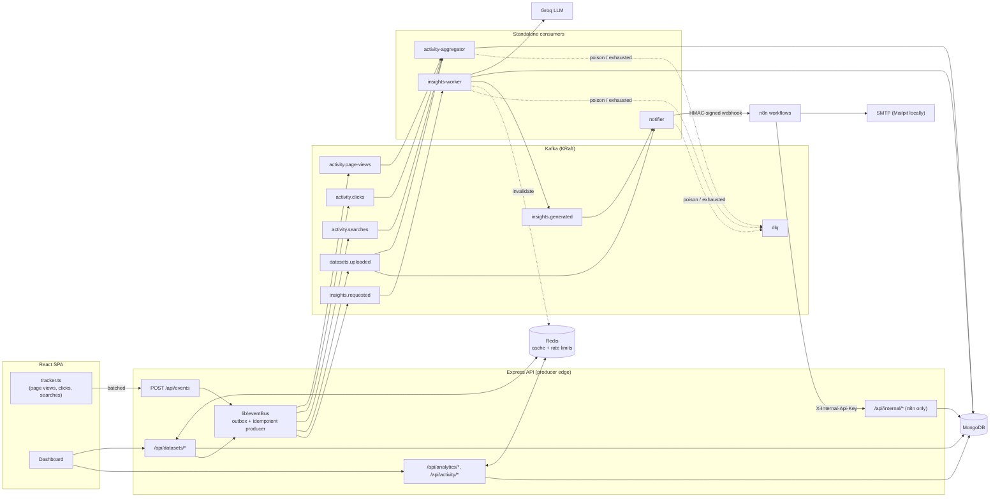
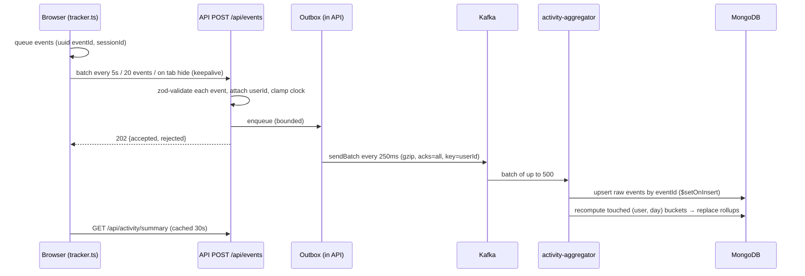
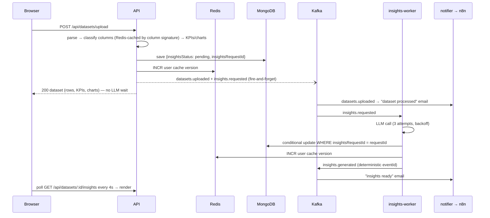

# VizIntel — Event-Driven Architecture (Kafka · Redis · n8n)

This document explains how Apache Kafka, Redis and n8n are integrated into the VizIntel dashboard, how data
flows through the system, why each decision was made, and how the design scales. For running it locally see
[LOCAL_SETUP.md](LOCAL_SETUP.md).

---

## 1. Goals and design principles

| Goal | How it is achieved |
|---|---|
| Responsive API under high event volume | Browser interactions are accepted with `202` and buffered into Kafka; no MongoDB write happens in the request path. |
| Decouple slow work from requests | AI insight generation and notifications run in standalone Kafka consumers (`INSIGHTS_MODE=async`). |
| Fast reads | Redis cache-aside for dataset lists/search, dataset bodies, KPIs/summary and analytics, with O(1) per-user invalidation. |
| Automation without code deploys | n8n workflows own emails, scheduled reports and insight retries; they talk to the API through a signed/keyed contract. |
| **Never disrupt existing behaviour** | Every integration is optional and **fails open**. No `KAFKA_BROKERS` → events run in-process. No `REDIS_URL` → cache bypassed. No `N8N_WEBHOOK_*` → notifications skipped. The original single-process deployment keeps working with zero new configuration. |
| Correctness under at-least-once delivery | Every consumer is idempotent, so retries, redeliveries and DLQ replays never double count or double email. |

---

## 2. System overview



All backend roles ship as **one Docker image**: the API (`node index.js`) and each worker
(`node workers/<name>Consumer.js`) are just different commands on the same build.

---

## 3. Components

### 3.1 Express API — the producer edge

| Endpoint | Purpose |
|---|---|
| `POST /api/events` | Batched browser interactions (≤50 per request, 64 KB body). Each event validated independently with zod; valid ones enriched with the authenticated user and handed to the outbox; responds `202 {accepted, rejected, errors}`. Optional auth (anonymous events allowed, an invalid token never causes a `401`). Rate limited per user/IP. |
| `GET /api/datasets?q=&page=&limit=` | Paginated list + case-insensitive name search. **Excludes row arrays** (`?include=data` restores the legacy payload). Body is still an array; `X-Total-Count`, `X-Page`, `X-Page-Size` headers carry pagination. Cached. |
| `GET /api/datasets/:id` | Full dataset including rows, served straight from Redis on a hit. |
| `GET /api/datasets/:id/insights` | Lightweight insight-status probe polled by the UI while generation runs in the background. |
| `POST /api/datasets/:id/insights/regenerate` | User-triggered retry. Returns `202`. |
| `GET /api/activity/summary?days=7` | The user's rolled-up interaction metrics (from the Kafka aggregator). |
| `GET /health` | Unchanged liveness text used by UptimeRobot. |
| `GET /health/ready` | Readiness JSON: MongoDB (required), Redis, Kafka (`healthy`, outbox size), cache hit ratio. `503` only if MongoDB is down. |
| `/api/internal/*` | n8n-only API (see §3.6), protected by `X-Internal-Api-Key`. |

### 3.2 Event bus (`backend/lib/eventBus.js`)

One abstraction, two transports, two delivery policies:

| | Kafka mode (`KAFKA_BROKERS` set) | Inline mode (no Kafka) |
|---|---|---|
| Transport | Idempotent KafkaJS producer, `acks=all`, gzip, keyed by `userId` | In-process handlers — the **same handler functions** the consumers run |
| Activity events (`enqueue`) | Bounded in-memory **outbox**, micro-batched (linger 250 ms / ≤500 msgs per produce request). Failures re-queue with exponential backoff. | Same outbox, flushed into the handlers |
| Critical events (`publish`) | Sent immediately (8 s timeout). **On failure → falls back to in-process handlers** | Dispatched in-process after the response is sent |
| Backpressure | Outbox full → `POST /api/events` answers `503 + Retry-After`; the browser tracker keeps its events and retries | Same |

The subscription registry (`backend/events/registry.js`) is the single source of truth for which handler
processes which topics. Inline mode registers it in-process; Kafka mode turns each entry into a consumer group.

**Event envelope** (every Kafka message, validated again by consumers):

```json
{
  "eventId": "3f0c1d1e-7a7b-4f0e-9a51-2a0f3c9b8e11",
  "type": "click",
  "version": 1,
  "occurredAt": "2026-11-11T09:09:31.120Z",
  "receivedAt": "2026-11-11T09:09:31.402Z",
  "source": "web",
  "userId": "6af430ccd7a483a0392a7f13",
  "anonymousId": null,
  "sessionId": "b1c7…",
  "data": { "path": "/dashboard", "properties": { "target": "dataset_select", "datasetId": "…" }, "userAgent": "…" }
}
```

Events carry **ids, not personal data**: the notifier looks up names/emails in MongoDB at send time.
Client clocks are clamped (future > 5 min or older than 7 days → server receive time).

### 3.3 Kafka topics

All names are prefixed with `KAFKA_TOPIC_PREFIX` (default `vizintel`) so environments can share a cluster.
Broker auto-creation is **disabled**; topics are provisioned explicitly by `npm run kafka:setup` (also run by
every worker at startup), so a typo can never silently create a 1-partition topic.

| Topic | Partitions | Retention | Key | Producer | Consumers (groups) |
|---|---|---|---|---|---|
| `activity.page-views` | 6 | 7 d | userId | API (`POST /api/events`) | activity-aggregator |
| `activity.clicks` | 6 | 7 d | userId | API | activity-aggregator |
| `activity.searches` | 3 | 7 d | userId | API | activity-aggregator |
| `datasets.uploaded` | 3 | 14 d | userId | API (upload) | activity-aggregator, notifier |
| `insights.requested` | 3 | 14 d | userId | API (upload / regenerate / n8n) | insights-worker |
| `insights.generated` | 3 | 14 d | userId | insights-worker | notifier |
| `dlq` | 1 | 30 d | original key | all workers | `npm run kafka:replay-dlq` |

Keying by user keeps each user's events ordered within one partition and co-locates them for the per-user rollup.

### 3.4 Consumer groups (`backend/workers/`)

| Group | Topics | Batch | Concurrency | Handler |
|---|---|---|---|---|
| `vizintel.activity-aggregator` | page-views, clicks, searches, datasets.uploaded | 500 | 3 partitions | Raw events → idempotent daily rollups in MongoDB |
| `vizintel.notifier` | datasets.uploaded, insights.generated | 10 | 2 | Enrich from MongoDB → HMAC-signed n8n webhook |
| `vizintel.insights-worker` | insights.requested | 1 | 2 | LLM call → conditional write → `insights.generated` |

Groups are independent (pub/sub fan-out: `datasets.uploaded` is consumed by two groups). Within a group,
Kafka spreads partitions across instances — run more containers to scale (`docker compose up --scale
activity-worker=3`), up to the partition count.

Runtime behaviour (`workers/runtime.js`):
- **Manual offset resolution**: an offset is resolved only after its chunk is processed, then committed.
- **Retry → bisect → DLQ**: a failing chunk is retried with exponential backoff; if it still fails it is split
  into single events so one poison message can't dead-letter its healthy neighbours. Undecodable/invalid
  messages go straight to the DLQ with headers (`x-original-topic/partition/offset`, `x-error`, `x-consumer-group`).
- **Keep-alive heartbeats** during slow handlers (LLM calls) so the group doesn't rebalance mid-work.
- **Offset reset = earliest** for partitions with no committed offset (see §5.4).
- **Health**: `WORKER_HEALTH_PORT` serves JSON (`running`, processed, dead-lettered, retries, lag per partition);
  `503` while a consumer is crashed/rejoining. If KafkaJS gives up restarting, the process exits so the
  supervisor (Docker/Kubernetes) replaces it.
- **Graceful shutdown** on SIGINT/SIGTERM: finish the in-flight batch, commit, leave the group, close connections.

### 3.5 Redis

| Use | Key pattern | TTL | Invalidation |
|---|---|---|---|
| Dataset list / search pages | `{prefix}u:{userId}:v{N}:datasets:{hash(query)}` | 120 s | user namespace bump |
| Dataset body (rows) | `{prefix}u:{userId}:v{N}:dataset:{id}` | 600 s | user namespace bump |
| Dashboard summary | `…:v{N}:summary` | 60 s | user namespace bump |
| Per-dataset analytics | `…:v{N}:analytics:{id}` | 300 s | user namespace bump |
| Activity summary | `{prefix}u:{userId}:activity:{days}` | 30 s | TTL only (changes continuously) |
| LLM column classification | `{prefix}colclass:{sha256(column names+types)}` | 7 d | content-addressed (immutable) |
| Rate limits | `{prefix}rl:{name}:{user-or-ip}:{window}` | window | fixed window |

Techniques:
- **Versioned namespaces**: every user-scoped key embeds `v{N}`. A write (upload, insights finished, regeneration
  requested) runs one `INCR` and every cached view for that user — including search variants nobody can enumerate —
  becomes unreachable instantly. No `KEYS`/`SCAN`; orphans expire via TTL.
- **Raw JSON passthrough**: values are stored serialized; a hit is written straight to the response
  (`res.send(json)`), skipping `JSON.parse`/`stringify` of multi-MB row arrays.
- **Single-flight**: concurrent misses on one key share a single loader call (stampede protection).
- **TTL jitter** (+0–10 %) so keys written together don't expire together.
- **Size guard**: values over `CACHE_MAX_ITEM_BYTES` (2 MB) are not cached; Redis runs with
  `maxmemory 256mb` + `allkeys-lru` and no persistence (everything is rebuildable from MongoDB).
- **Fail-fast client**: `enableOfflineQueue: false`, so an outage bypasses the cache instead of hanging requests.
- Responses carry `X-Cache: HIT | MISS | BYPASS`.

### 3.6 n8n workflows (`n8n/workflows/`)

| Workflow | Trigger | What it does |
|---|---|---|
| **01 Dataset Upload Notification** | Webhook `vizintel/dataset-uploaded` (from the notifier) | Verify HMAC → `202` → email "dataset processed" with KPI table and deep link → if insights already failed, call the API to regenerate them |
| **02 AI Insight Generation Trigger** | Every 15 min · manual "Run Sweep Now" · webhook `vizintel/insights/regenerate` (needs the internal key) | Fetch failed/stale-pending insights (`GET /api/internal/insights/backlog`) → request regeneration for each. Datasets stop being retried after `INSIGHTS_MAX_ATTEMPTS` |
| **03 Weekly Analytics Report** | Monday 08:00 cron · manual "Send Report Now" | `GET /api/internal/reports/activity?days=7` → one HTML email per active user + an admin platform digest |
| **04 Insights Ready Email** | Webhook `vizintel/insights-generated` | Verify HMAC → if `ready`, email the insight bullets with a deep link |

The integration contract is symmetric:
- **API → n8n**: `X-VizIntel-Signature: sha256=HMAC(secret, "<timestamp>.<body>")` + `X-VizIntel-Timestamp`
  (rejected if older than 5 min) + `Idempotency-Key: <eventId>`. Unsigned/forged requests get `401`.
- **n8n → API**: `X-Internal-Api-Key`, compared in constant time; `/api/internal/*` is disabled unless the key is set.

### 3.7 MongoDB

| Collection | Notes | Indexes |
|---|---|---|
| `datasets` | + `rowCount`, `columnCount` (denormalised), insight lifecycle fields (`insightsStatus`, `insightsRequestId`, `insightsAttempts`, `insightsError`, `insightsUpdatedAt`) | `{user:1, createdAt:-1}` (list/search/summary), `{insightsStatus:1, updatedAt:1}` (sweeper), `{createdAt:-1}` (weekly report) |
| `activityevents` | Raw events; `_id = eventId` (idempotency ledger) | `{bucket:1, type:1}`, TTL 30 d |
| `activitymetrics` | One doc per user per UTC day: counters, unique sessions, top pages/clicks/searches | `{user:1, date:-1}`, `{date:-1}` |
| `notificationlogs` | `_id = eventId:channel`, delivery status | TTL 30 d |

Legacy datasets (pre-dating the new fields) are handled with `$ifNull` fallbacks; `npm run db:backfill-stats`
fills them in with a single server-side pipeline update.

---

## 4. Data flows

### 4.1 Interaction tracking (page views, clicks, searches)



Clicks are declarative: any element with `data-track="name"` (plus `data-track-*` attributes as properties) is
captured by one delegated listener; chart clicks are tracked from Chart.js `onClick`. Searches are tracked after
the debounced server-side search returns (with `resultCount`). Page views come from a router hook.

### 4.2 Dataset upload (async insights)



In `INSIGHTS_MODE=sync` (the default without Kafka) step 3 runs inside the request exactly like the original code.

### 4.3 Insight self-healing

LLM failures are recorded as `insightsStatus: failed` (not thrown), so they never block a partition. Three
independent paths retry them: the user's **Retry** button, n8n's immediate branch on upload (when the
synchronous attempt already failed), and n8n's 15-minute **sweeper**. All three call
`requestInsightsRegeneration()`, which de-duplicates (a fresh pending request is reused; a conditional update
on the previous `insightsRequestId` makes concurrent callers collapse into one generation).

### 4.4 Cached read path

`controller → cache.userKey() → Redis GET` → hit: send the stored JSON string as-is · miss: single-flight
loader → MongoDB (projection/aggregation) → `SET EX ttl±jitter` → send. Redis down → loader only (`BYPASS`).

---

## 5. Reliability

### 5.1 Delivery semantics

Kafka delivers **at least once**. Exactly-once *results* come from idempotent handlers:

| Handler | Idempotency mechanism |
|---|---|
| Activity aggregator | Raw events upserted with `_id = eventId` (`$setOnInsert`); rollups are **recomputed** from raw events for touched buckets (never `$inc`), so processing twice yields the same document. A monotonic guard (`replace only if totalEvents ≥ stored`) makes concurrent recomputes from different partitions converge on the freshest result. |
| Notifier | `NotificationLog` keyed by `eventId:channel`; already-`sent` events are skipped. Derived events use deterministic ids (`insights-generated:<requestId>`), so a retried producer emits the *same* id. |
| Insights worker | Skips superseded requests (`insightsRequestId` mismatch); final write is conditional on the request id, so a slow stale worker can't overwrite newer results; a redelivered completed request only re-emits its (deduplicated) completion event. |
| Browser tracker | Client-generated `eventId`s, so a retried batch is collapsed downstream. |

### 5.2 Retries

| Where | Policy |
|---|---|
| Producer outbox flush | Unlimited, exponential backoff 0.5 s → 30 s with jitter; bounded queue |
| Critical publish | 8 s timeout → in-process fallback (3 attempts) |
| Consumer chunk | `WORKER_MAX_ATTEMPTS` (5) with backoff → bisect → 2 attempts per event → DLQ |
| LLM call (worker) | 3 attempts on network/408/429/5xx, 2–10 s backoff → mark `failed` |
| n8n webhook | 3 attempts on transient errors, then the consumer retries the event |
| n8n HTTP/email nodes | `retryOnFail`, 3 tries, 5 s apart |
| Browser tracker | Re-queue on 429/5xx/network, exponential backoff up to 60 s, honours `Retry-After` |

### 5.3 Dead-letter queue

Poison messages land in `vizintel.dlq` with diagnostic headers and the partition keeps moving. After a fix:
`npm run kafka:replay-dlq -- --dry-run`, then without `--dry-run` (optionally `--topic=… --limit=…`).
Replays are safe because every handler is idempotent.

### 5.4 Offset reset policy (lesson learned in testing)

Workers subscribe with `fromBeginning: true`, which only applies to partitions **without** a committed offset
(Kafka's `auto.offset.reset=earliest`); committed offsets always win. During a broker-outage drill the original
`latest` setting silently skipped events that had been produced to a partition the group had never consumed —
exactly the scenario of a first deployment or a consumer rejoining after downtime. `earliest` plus idempotent
handlers means nothing is lost and nothing is double counted (verified: the recovered events were counted once
and existing totals were unchanged).

### 5.5 Graceful degradation matrix

| Dependency down | User impact | System behaviour |
|---|---|---|
| **Kafka** | None visible | Uploads succeed; critical events run in-process; activity events buffer in the outbox and flush on recovery; `/health/ready` reports `kafka.healthy:false` |
| **Redis** | Slightly slower reads | Cache and rate limits bypassed (`X-Cache: BYPASS`); invalidation resumes when it returns |
| **n8n** | Emails delayed | Notifier retries, then dead-letters; `NotificationLog` records failures; replay later |
| **LLM** | Insights show "Retry" | Status `failed`; n8n sweeper retries up to `INSIGHTS_MAX_ATTEMPTS` |
| **MongoDB** | Outage | `/health/ready` → `503`; consumers retry with backoff, then DLQ |
| **A worker** | Delayed metrics/emails | Kafka retains events; consumer lag grows; the group rebalances to remaining instances |

---

## 6. Security

- **n8n webhooks**: HMAC-SHA256 over `timestamp.body`, 5-minute replay window, constant-time comparison inside n8n.
- **Internal API**: `X-Internal-Api-Key` (SHA-256 digests compared with `timingSafeEqual`), disabled when unset; no user JWT accepted there.
- **Rate limiting** (Redis, shared across instances): auth 30/min per IP, uploads/regenerations 10/min per user, events 240/min per user/IP.
- **Input hardening**: zod validation on all new inputs (bounded arrays, string lengths, property counts); regex-escaped search; 64 KB body limit on `/api/events`; 15 MB upload limit (memory storage was previously unbounded); ObjectId validation (no `CastError` 500s).
- **Ownership**: dataset reads query `{_id, user}` → `404` for other users' ids (no existence leak).
- **PII minimisation**: Kafka events carry ids only; emails/names are resolved at send time. Log redaction for `Authorization`, cookies, the internal key and passwords.
- **CORS**: still open by default (previous behaviour); set `CORS_ORIGIN` to lock it down. `TRUST_PROXY` for correct client IPs behind a proxy.
- Dependencies: semver-compatible `npm audit fix` (axios, mongoose, multer, body-parser…), zod 4 (fixes a collection-validation memory-exhaustion advisory relevant to the ingestion endpoint). `xlsx` still has an open advisory: SheetJS no longer publishes fixes to npm (see §9).

---

## 7. Performance optimizations

| Area | Before | After |
|---|---|---|
| Dataset list | Returned **every row of every dataset** | Metadata only, paginated (50), counts computed in MongoDB; rows loaded lazily per dataset |
| Dashboard summary | Loaded all documents (all rows) into Node to count rows | One aggregation: project counts away from rows → `$facet` totals + recent 5 |
| Per-dataset analytics | Loaded the full document | `$match` + `$project` with `$size` computed server-side |
| Repeated reads | MongoDB every time | Redis cache-aside, raw JSON passthrough |
| Column classification | One LLM call per upload | Cached by column signature for 7 days (repeat report templates skip the call) |
| Upload latency | Blocked on two LLM calls | Async mode: blocked on at most one (cached) classification call; insights in background |
| Interaction writes | n/a | 202 with zero DB I/O; consumer batches up to 500 events per MongoDB round trip |
| Responses | Uncompressed | gzip (`compression`, threshold 1 KB); row arrays compress 5–10× |
| Indexes | Only `_id` / unique email | Compound/TTL indexes listed in §3.7 |
| Frontend bundle | Single 550 KB chunk | Vendor chunks (react / charts / markdown) cached independently across deploys |
| LLM call | No timeout | 30 s timeout (configurable) |

Measured on a local machine during the end-to-end run (tiny test files, fake LLM — indicative, not a benchmark):
async upload response **86 ms**; `POST /api/events` **15 ms**; cached list read **54 ms → 8 ms** (MISS → HIT).

---

## 8. Scalability

- **API**: stateless; scale horizontally behind a load balancer. Redis makes caching and rate limits shared.
  The outbox is per-instance (bounded); events in it are lost only if an instance crashes hard — a deliberate
  trade-off for analytics events (critical events go straight to Kafka or run in-process).
- **Consumers**: scale each group independently up to its partition count (6 for page views/clicks).
  Partitions can be increased later (note: remaps keys, so do it in a quiet period; `ensureTopics` only warns).
- **Kafka as a shock absorber**: a traffic spike grows consumer lag instead of MongoDB write load;
  `npm run kafka:lag` shows per-partition lag. Batching (500/event batch) turns N events into a handful of DB ops.
- **MongoDB**: activity rollups keep dashboard/report reads O(days) instead of O(events); raw events expire after 30 days.
- **n8n**: runs out of the request path; for higher volume move it to queue mode (Redis + n8n workers).
- **Managed services**: SASL/SSL Kafka settings (Confluent Cloud, Upstash, Aiven, MSK), `rediss://` URLs, Atlas.

---

## 9. Observability and operations

| Tool | Command / endpoint |
|---|---|
| Structured JSON logs (pino) with request ids (`X-Request-Id`) | every process; pretty-printed in development |
| API readiness | `GET /health/ready` |
| Pipeline status (event bus stats, cache hit ratio, Redis) | `GET /api/internal/pipeline` (internal key) |
| Worker health | `GET :WORKER_HEALTH_PORT/` |
| Consumer group state + lag | `npm run kafka:lag` |
| Topic provisioning | `npm run kafka:setup` |
| DLQ replay | `npm run kafka:replay-dlq -- --dry-run` |
| Legacy data backfill | `npm run db:backfill-stats` |
| Kafka UI | `docker compose --profile tools up -d kafka-ui` → http://localhost:8080 |
| Email inbox | Mailpit → http://localhost:8025 |

---

## 10. Behaviour changes to be aware of

All are backwards compatible for the bundled frontend, but matter for any other API client:

- `GET /api/datasets` omits `originalData` by default and returns at most 50 items (`?include=data`, `?page=`, `?limit=` ≤ 100).
- Another user's dataset id now returns `404` instead of `401`.
- Errors are always JSON `{ msg, code, requestId }`; upload parse failures are `400` (previously a plain-text `500`), oversized files `413`.
- `MONGO_URI` and `JWT_SECRET` are validated at startup (fail fast).
- With `INSIGHTS_MODE=async`, the upload response has `insightsStatus: "pending"` and empty `insights`.
- When Redis is configured, rate limits apply (`429` + `Retry-After`).

---

## 11. Trade-offs and future work

| Decision | Trade-off |
|---|---|
| KafkaJS (pure JS) over `@confluentinc/kafka-javascript` (librdkafka) | Zero native build on Windows/Alpine; but KafkaJS is in maintenance mode — the event bus is the only module to change if migrating. |
| Recompute-from-raw rollups over `$inc` | Idempotent by construction; costs one aggregation per touched bucket per batch (bounded by the per-user-day key). |
| In-memory outbox over a persistent (DB) outbox | No extra write per event; a hard crash can lose up to `EVENTS_OUTBOX_MAX` buffered analytics events. Domain events don't use it. |
| n8n for notifications/reports | Non-engineers can change emails/schedules without a deploy; adds a service to run and secure. |
| Rows still embedded in `datasets` | Kept to avoid a data migration; projections avoid transferring them, but the 16 MB document cap remains. |

Next steps: move rows to their own collection/object storage; transactional outbox for domain events
(MongoDB change streams → Kafka); Prometheus metrics (lag, cache hit ratio, outbox depth) + alerts;
schema registry (Avro/JSON Schema) for event contracts; n8n queue mode; WebSocket/SSE push instead of polling
for insight status; replace `xlsx` from npm with the SheetJS CDN build or another parser.

---

## 12. Verification performed

- **Unit tests** (`npm test`, Node test runner): event schemas, retry/backoff, rollup builder, HMAC signing and
  the n8n verification algorithm, event bus (batching, bounded outbox, retry, fan-out), cache fail-open.
- **Integration test** (`TEST_MONGO_URI=… npm test`): full HTTP flow in inline mode against a throwaway database —
  auth, upload (sync and async insights), list/search/detail, analytics shapes, event ingestion → aggregation,
  idempotent redelivery, signed n8n webhooks, internal API, de-duplicated regeneration.
- **Live end-to-end run** with Docker (Kafka KRaft, Redis, n8n 1.123, Mailpit) — 16/16 checks: async upload,
  insights worker, cache MISS→HIT and namespace invalidation, classification cache (1 LLM call for 2 uploads),
  activity aggregation, idempotent redelivery, all four n8n workflows executing and delivering email, rate
  limiting; plus DLQ routing and replay, consumer lag, and a **Kafka outage drill** (uploads and insights kept
  working, buffered events delivered after recovery, health signals accurate).
